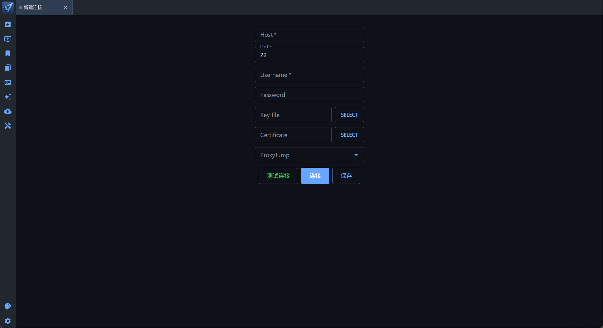
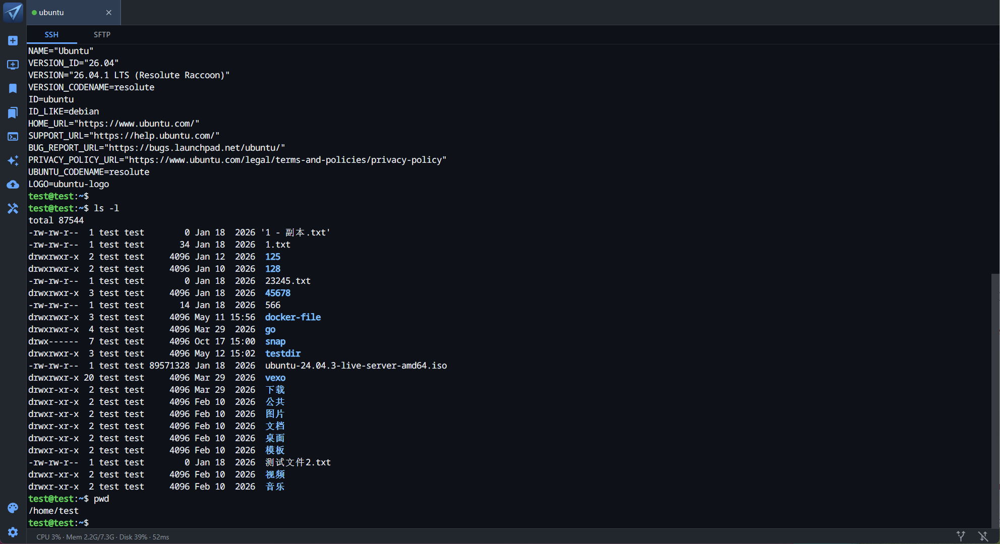
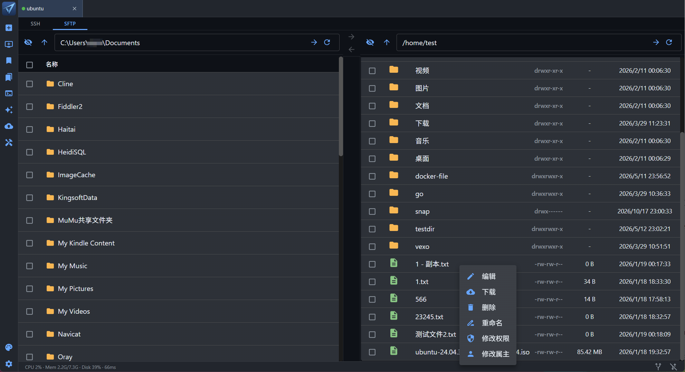
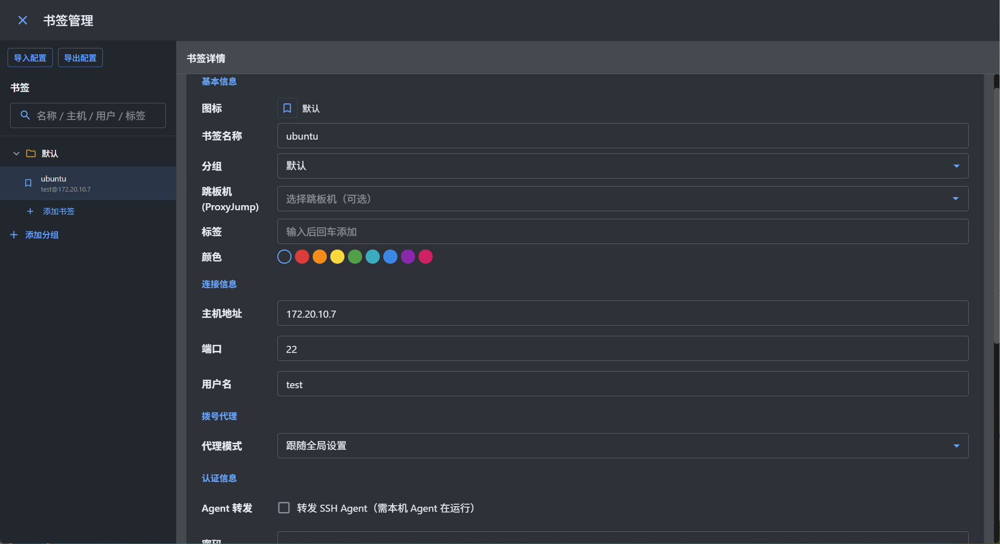
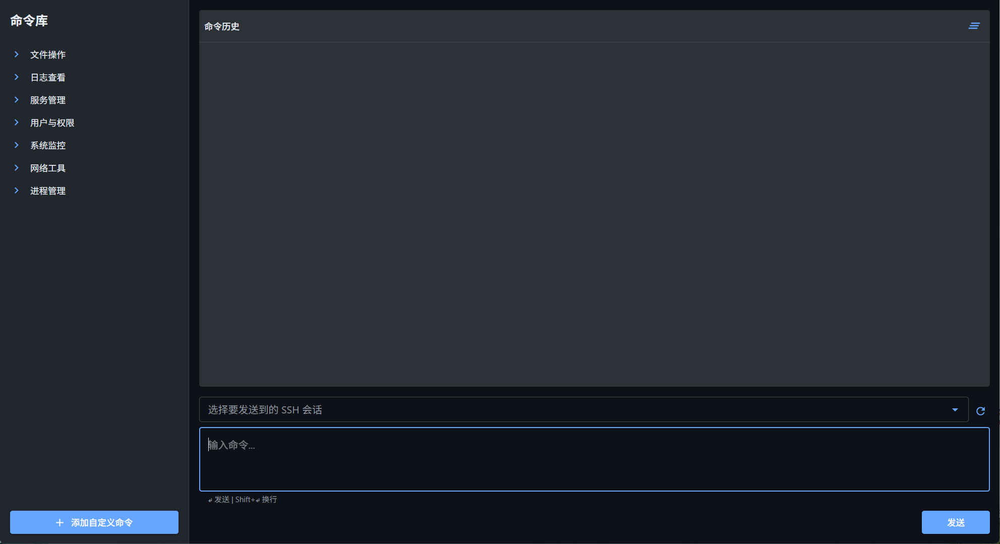
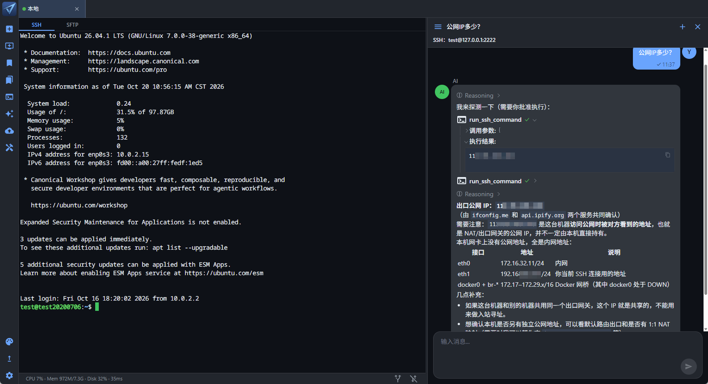
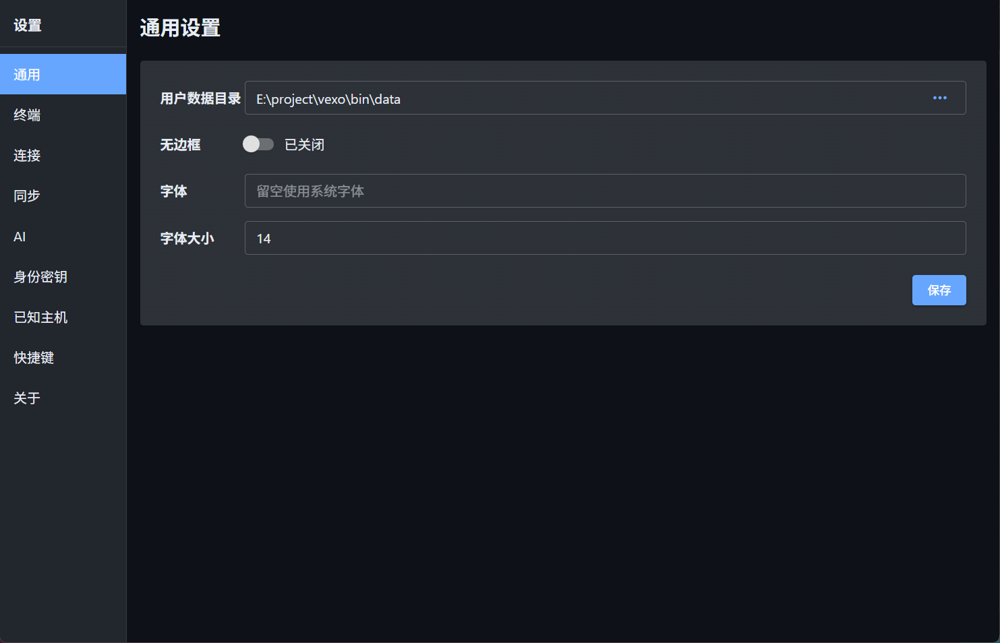

# Vela — Cross-platform SSH & SFTP GUI client

[English](README.en.md) | [中文](README.md)

[](https://github.com/ilaziness/vela/actions/workflows/release.yml)
[](https://github.com/ilaziness/vela/releases/latest)
[](https://github.com/ilaziness/vela/releases)
[](https://go.dev)
[](https://wails.io)
[](LICENSE)

A modern, cross-platform SSH and SFTP desktop GUI built with Go and Wails v3.

---

## 📖 Overview

**Vela** is a fast, compact desktop app that puts SSH and SFTP in a native GUI. Built with [Wails v3](https://wails.io) and Go, it runs on Windows, macOS, and Linux, giving developers and operators a single tool for remote access and file management. The UI is available in English, Simplified Chinese, and Traditional Chinese.

---

## ✨ Features

**Connection & auth**

- SSH login: password, private key, SSH Agent (Windows Pageant / macOS·Linux `SSH_AUTH_SOCK`), OpenSSH certificates, keyboard-interactive (OTP / 2FA)
- Generate key pairs in-app; copy the public key; store the private key encrypted with the master password, or export it
- Secrets protected by a master password (Argon2id + AES-GCM, in-process Vault)
- ProxyJump; agent forwarding (`ForwardAgent`) so the remote host can use keys from the local agent
- Dial through HTTP / SOCKS5 (global, or per bookmark: inherit / none / custom)
- Keepalive and auto-reconnect; first-seen host keys, mismatch review, and known_hosts management
- Import and export `~/.ssh/config`; bookmarks can set startup commands, environment variables, and `TERM`
- Port forwarding: local, remote, and SOCKS5 dynamic

**Terminal**

- Multiple tabs: switch, drag, copy, refresh; in-terminal search (shortcut / context menu)
- Session log: start/stop from the context menu and save terminal output to a local file (stdin is not recorded)
- Zmodem (rz/sz): detect the protocol in the terminal, pick a folder or files, and show progress in the terminal
- Command history hints

**SFTP & bookmarks**

- Dual-pane SFTP: local and remote directories side by side
- File browser: upload, download, delete, rename, edit in place; chmod / chown on the remote side
- Resume interrupted transfers; retry failed jobs; persist unfinished queues (restored per bookmark)
- Multi-select batch download and delete; transfer task list
- Bookmarks and groups for frequent hosts

**Workflow**

- Command library: snippets sent to multiple sessions in one click
- Languages: English, Simplified Chinese, Traditional Chinese
- Themes: light, dark, eye-care
- Encrypted remote backup and restore across devices, with version history
- Automatic update check, download, and install
- AI sidebar: diagnose issues and run commands (with approval), plus remote exec, local filesystem tools (directory allowlist), web search, and custom MCP / Skill extensions

---

## 📸 Screenshots

> Main screens:

### Main window — SSH terminal


_Multi-tab SSH terminal_


_Multi-tab SSH terminal_

### SFTP file browser


_File management_

### Bookmarks


_Saved connection settings_

### Command library



### AI sidebar



### Settings



---

## 📦 Download & install

Get a build for your platform from [Releases](https://github.com/ilaziness/vela/releases):

| Platform | Asset | Notes |
| -------- | ----- | ----- |
| Windows | `Vela_*_windows_amd64.zip` | Unzip and run `Vela.exe` |
| Linux | `Vela_*_linux_amd64.tar.gz` | Unzip and run `Vela` |
| macOS | `Vela_*_darwin_arm64.zip` | Unzip to `Vela.app` (see below) |

### macOS

Only **Apple Silicon (arm64)** builds are published. Intel Macs are not supported.

After a browser download, macOS may block the first launch (nothing happens, “unidentified developer”, or “damaged”). Open it as follows:

1. Unzip to get `Vela.app` (do not open it from inside the zip).
2. In Terminal (adjust the path if needed):

```bash
xattr -cr ~/Downloads/Vela.app
open ~/Downloads/Vela.app
```

3. If it is still blocked: in Finder, **Control-click → Open** and confirm, or use **System Settings → Privacy & Security → Open Anyway**.

---

## AI: MCP and Skills

Config lives in the **user data directory** (**Settings → General → User data directory**, default `data` next to the app).

You can also open the files or folders, toggle enablement, and refresh the list under **Settings → AI → MCP / Skills**.

### MCP

The format matches common Cursor / Claude Code `mcp.json`: a top-level `mcpServers` object keyed by server name.

1. Open `mcp.json` in the user data directory (created as `{"mcpServers":{}}` if missing).
2. Add servers under `mcpServers`, save, then click Refresh on the settings page.
3. Toggle enable/disable. Green means reachable; red means enabled but currently unreachable. Only servers that are both enabled and available are given to the AI. MCP tool calls in chat require your approval.

**Fields** (each `mcpServers.<name>` entry)

| Field | Required | Description |
| ----- | -------- | ----------- |
| `command` / `args` / `env` | for stdio | Launch command and args; `env` is an object, e.g. `{"API_KEY":"value"}` |
| `url` / `headers` | for http | Server URL and request headers (e.g. Authorization) |
| `type` | no | `stdio` or `http`; omitted: `command` implies stdio, `url` implies http |
| `enabled` | no | Whether it is on; default on if omitted (the settings toggle writes this field) |

Secrets in `mcp.json` are stored in plaintext. Keep that file private.

**stdio example**

```json
{
  "mcpServers": {
    "example-time": {
      "command": "uvx",
      "args": ["mcp-server-time"],
      "env": {
        "API_KEY": "value"
      }
    }
  }
}
```

**http example**

```json
{
  "mcpServers": {
    "remote-docs": {
      "url": "https://mcp.example.com/mcp",
      "headers": {
        "Authorization": "Bearer your-token"
      }
    }
  }
}
```

### Skills

1. Create a `skills` folder in the user data directory (or use **Open skills directory** on the settings page).
2. One subfolder per skill, with a `SKILL.md` inside, for example:

```
data/skills/my-skill/SKILL.md
```

3. Refresh on the settings page and use the toggles. Enabled skills are loaded by the AI without approval.

**SKILL.md example**

```markdown
---
description: Short description of what this skill does (optional, recommended)
---

# My skill

Detailed instructions for the AI…
```

The folder name is the skill name. After editing files, click Refresh in settings to pick up changes.

## 📄 License

This project is licensed under the [Apache License 2.0](LICENSE).

```
Copyright 2024 Vela Contributors

Licensed under the Apache License, Version 2.0 (the "License");
you may not use this file except in compliance with the License.
You may obtain a copy of the License at

    http://www.apache.org/licenses/LICENSE-2.0

Unless required by applicable law or agreed to in writing, software
distributed under the License is distributed on an "AS IS" BASIS,
WITHOUT WARRANTIES OR CONDITIONS OF ANY KIND, either express or implied.
See the License for the specific language governing permissions and
limitations under the License.
```
