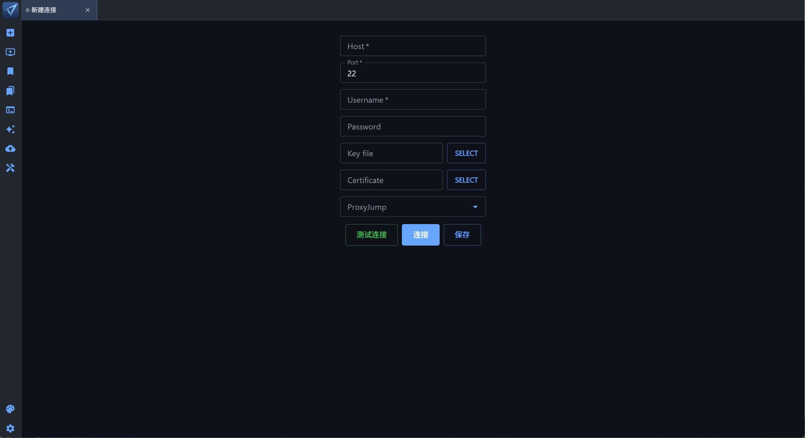
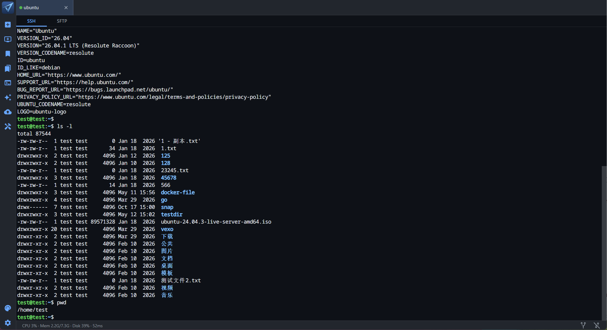
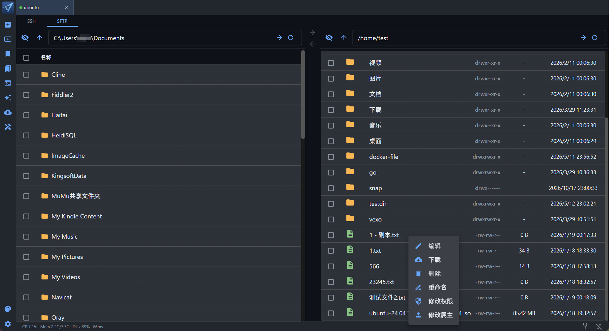
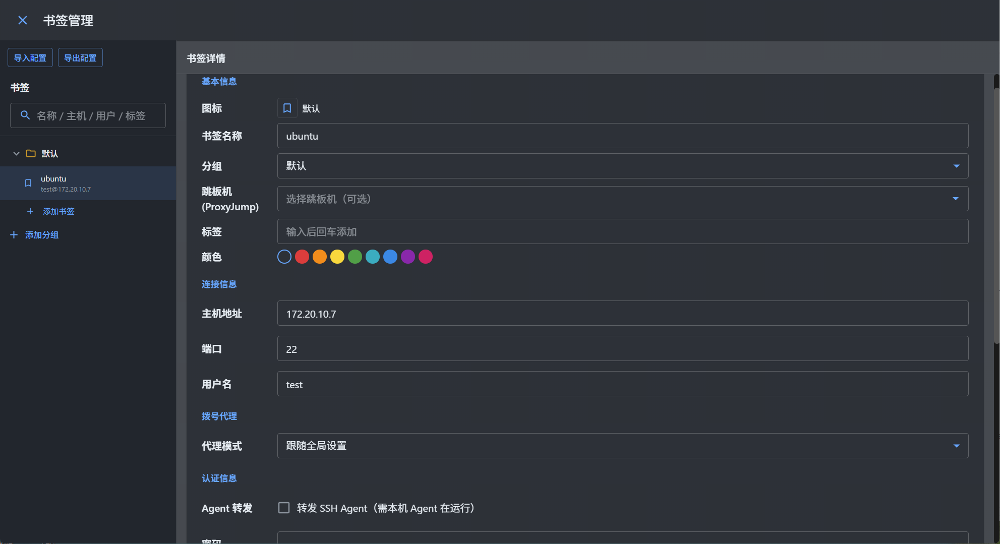
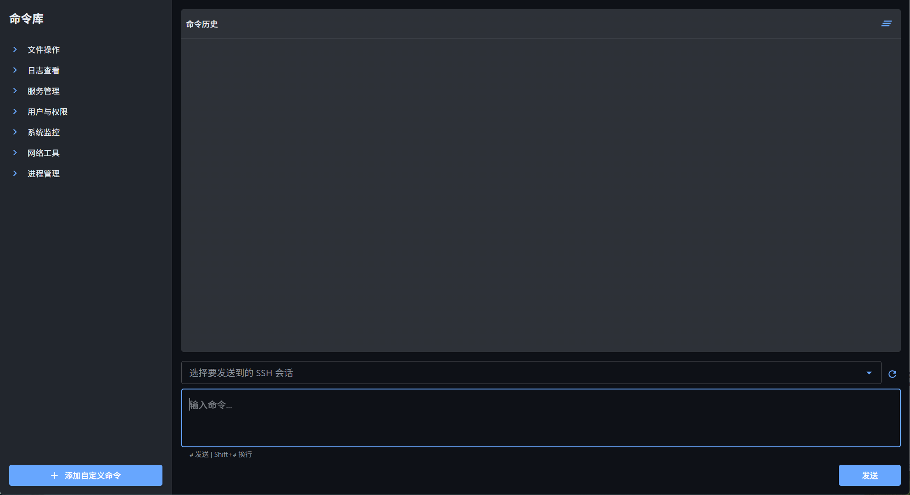
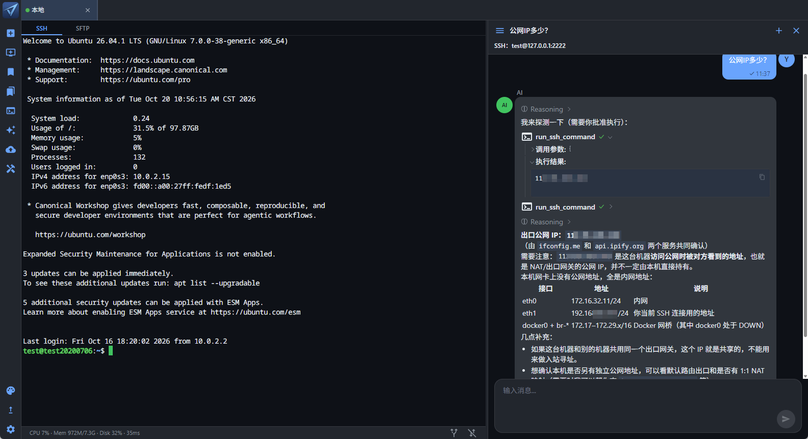
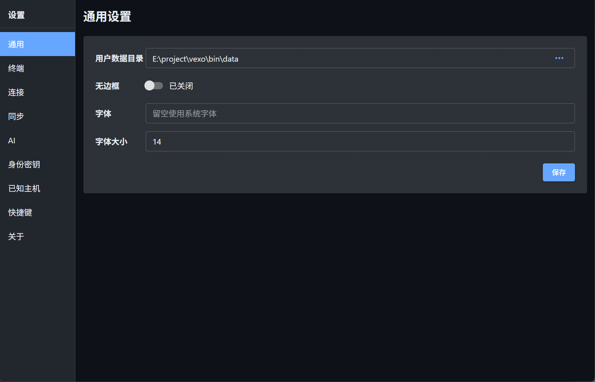

# Vela — 跨平台 SSH / SFTP / 串口 AI GUI 客户端

[中文](README.md) | [English](README.en.md)

[](https://github.com/ilaziness/vela/actions/workflows/release.yml)
[](https://github.com/ilaziness/vela/releases/latest)
[](https://github.com/ilaziness/vela/releases)
[](https://go.dev)
[](https://github.com/go-gui-org/go-gui)
[](LICENSE)

面向开发与运维的跨平台 SSH / SFTP / 串口桌面客户端，内置 AI 助手。

---

## 📖 简介

**Vela** 是一款跨平台桌面客户端，用来做 SSH 远程登录、SFTP 文件管理、本机串口控制，以及侧栏里的 AI 助手。基于 Go、[go-gui](https://github.com/go-gui-org/go-gui) 与 [go-term](https://github.com/go-gui-org/go-term) 构建，原生运行于 Windows、macOS 和 Linux。界面支持英语、简体中文和繁体中文。

---

## ✨ 特性

**连接与认证**

- SSH 登录：密码、私钥、证书、二次验证、SSH Agent
- 本机串口直连，会话开在和 SSH 相同的终端标签里
- 跳板、HTTP / SOCKS 代理，以及本地 / 远程 / 动态端口转发
- 应用内生成密钥，主密码保护口令和私钥
- 连接保活与自动重连，主机密钥可确认、可管理
- 导入、导出 OpenSSH 配置

**终端**

- 多标签终端，SSH 与串口共用
- 终端内搜索、中文编码、会话日志
- SSH 会话支持 Zmodem（rz / sz）传文件
- 输入时提示历史命令

**SFTP 与书签**

- 本机与远程左右分栏，拖拽传输
- 断点续传、失败重试，未完成任务下次打开还在
- 远程文件就地编辑，可改权限和属主
- 书签分组，收藏 SSH 主机和串口设备

**效率与运维**

- 命令库：常用片段一次发到多个会话
- 侧栏 AI 助手：针对当前会话给建议，远程执行需批准；可接本地文件、网络搜索、MCP 和 Skill
- 备份在本机加密后存到自建服务、WebDAV 或 S3，换设备可恢复
- 英语、简体中文、繁体中文；亮色 / 暗色 / 护眼主题；自动检查更新

---

## 📸 截图

> 以下截图展示了 Vela 的主要界面：

### 主界面 - SSH 终端


_多标签 SSH 终端界面_


_多标签 SSH 终端界面_

### SFTP 文件浏览器


_直观的文件管理界面_

### 书签管理


_服务器连接配置管理_

### 命令库



### AI 助手



### 设置



---

## 📦 下载与安装

从 [Releases](https://github.com/ilaziness/vela/releases) 下载对应平台的包：

| 平台    | 资源文件                    | 说明                          |
| ------- | --------------------------- | ----------------------------- |
| Windows | `Vela_*_windows_amd64.zip`  | 解压后运行 `Vela.exe`         |
| Linux   | `Vela_*_linux_amd64.tar.gz` | 解压后运行 `Vela`             |
| macOS   | `Vela_*_darwin_arm64.zip`   | 解压得到 `Vela.app`（见下方） |

### macOS

当前仅提供 **Apple Silicon（arm64）** 安装包，Intel Mac 无法使用。

从浏览器下载后，macOS 可能拦截首次启动（双击无反应、提示无法验证开发者，或提示已损坏）。按下面步骤打开即可：

1. 解压 zip，得到 `Vela.app`（不要在压缩包内直接打开）。
2. 在终端执行（路径换成实际解压位置）：

```bash
xattr -cr ~/Downloads/Vela.app
open ~/Downloads/Vela.app
```

3. 若仍被拦：在 Finder 中对 `Vela.app` **右键 → 打开** 并确认；或到 **系统设置 → 隐私与安全性** 中选择 **仍要打开**。

---

---

## AI：MCP 与 Skills 配置说明

配置文件在「用户数据目录」下（**设置 → 通用 → 用户数据目录**，默认是程序旁的 `data` 文件夹）。

也可在 **设置 → AI → MCP / Skills** 中打开对应文件或目录、开关启用状态，并刷新列表。

### 配置 MCP

格式与 Cursor / Claude Code 常见的 `mcp.json` 一致：顶层为 `mcpServers` 对象，服务器名为 key。

1. 打开用户数据目录中的 `mcp.json`（没有时程序会自动生成 `{"mcpServers":{}}`）。
2. 在 `mcpServers` 下添加服务器，保存后回到设置页点击「刷新」。
3. 用开关启用/禁用；绿点表示可连接，红点表示已开启但当前连不上。只有「已开启且可用」的服务器会提供给 AI；对话里调用 MCP 工具时需要你批准。

**字段说明**（每个 `mcpServers.<名称>` 条目）

| 字段                       | 必填     | 说明                                                                 |
| -------------------------- | -------- | -------------------------------------------------------------------- |
| `command` / `args` / `env` | stdio 时 | 启动命令、参数；`env` 为对象，如 `{"API_KEY":"value"}`               |
| `url` / `headers`          | http 时  | 服务地址与请求头（如 Authorization）                                 |
| `type`                     | 否       | `stdio` 或 `http`；省略时有 `command` 视为 stdio，有 `url` 视为 http |
| `enabled`                  | 否       | 是否启用，不写默认开启（设置页开关会写入此字段）                     |

注意：`mcp.json` 里的密钥是明文保存的，请妥善保管该文件。

**stdio 示例**

```json
{
  "mcpServers": {
    "example-time": {
      "command": "uvx",
      "args": ["mcp-server-time"],
      "env": {
        "API_KEY": "value"
      }
    }
  }
}
```

**http 示例**

```json
{
  "mcpServers": {
    "remote-docs": {
      "url": "https://mcp.example.com/mcp",
      "headers": {
        "Authorization": "Bearer 你的令牌"
      }
    }
  }
}
```

### 配置 Skills

1. 在用户数据目录下创建 `skills` 文件夹（没有时可在设置页点「打开 skills 目录」自动创建）。
2. 每个技能一个子文件夹，文件夹内放 `SKILL.md`，例如：

```
data/skills/my-skill/SKILL.md
```

3. 回到设置页刷新；用开关控制是否启用。已启用的技能可被 AI 直接加载，无需批准。

**SKILL.md 示例**

```markdown
---
description: 简要说明这个技能做什么（可选，建议填写）
---

# 我的技能

在这里写给 AI 的详细说明与步骤……
```

文件夹名就是技能名；改完文件后在设置里点「刷新」即可看到更新。

## 📄 许可证

本项目采用 [Apache License 2.0](LICENSE) 许可证。

```
Copyright 2024 Vela Contributors

Licensed under the Apache License, Version 2.0 (the "License");
you may not use this file except in compliance with the License.
You may obtain a copy of the License at

    http://www.apache.org/licenses/LICENSE-2.0

Unless required by applicable law or agreed to in writing, software
distributed under the License is distributed on an "AS IS" BASIS,
WITHOUT WARRANTIES OR CONDITIONS OF ANY KIND, either express or implied.
See the License for the specific language governing permissions and
limitations under the License.
```
